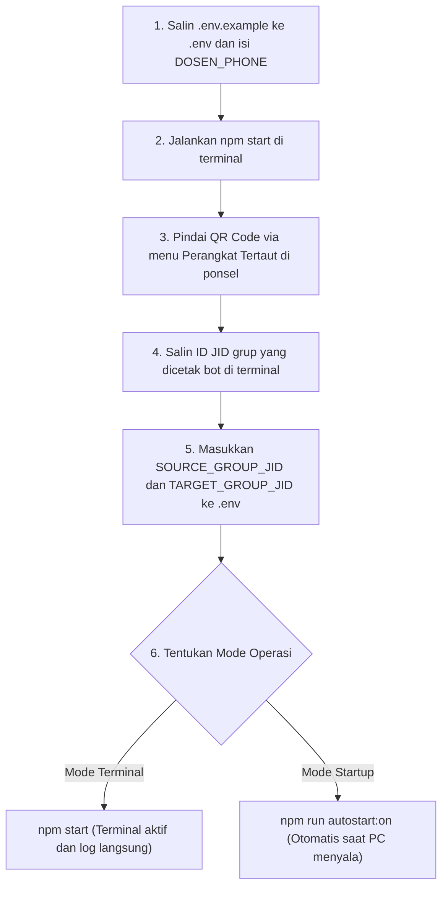

# Always First List - Panduan Operasional dan Teknis

Dokumen ini memuat panduan instalasi, konfigurasi berkas lingkungan, arsitektur logika siklus bimbingan, penggunaan konsol web lokal, mekanisme latar belakang Windows, serta penanganan kendala teknis.

---

## 1. Daftar Perintah Terminal

Semua perintah dijalankan di dalam direktori `wa-bimbingan-bot`:

| Perintah | Fungsi |
| :--- | :--- |
| `npm start` | Menjalankan bot di jendela terminal aktif (foreground) |
| `npm run autostart:on` | Mendaftarkan bot ke Windows Startup dan menjalankannya di latar belakang |
| `npm run autostart:off` | Menghapus bot dari Windows Startup dan mematikan proses di latar belakang |
| `npm run bg:start` | Menjalankan bot di latar belakang secara manual tanpa jendela terminal |
| `npm run bg:stop` | Menghentikan proses bot yang berjalan di latar belakang |
| `npm run clean` | Menghapus sesi lama Baileys jika baru saja logout dari WhatsApp ponsel |
| `npm run test:rules` | Menguji logika pencocokan kata kunci dan kalkulasi tanggal secara offline |

---

## 2. Alur Pemasangan dan Login Pertama Kali



### Langkah Pemasangan:
1. Pastikan Node.js versi 18 atau lebih baru telah terpasang di komputer.
2. Pasang modul dependensi:
   ```bash
   npm install
   ```
3. Salin berkas konfigurasi sampel:
   ```bash
   copy .env.example .env
   ```
4. Buka berkas `.env` dan masukkan nomor WhatsApp dosen pembimbing:
   ```env
   DOSEN_PHONE=6281234567890
   ```
5. Jalankan bot di terminal untuk inisialisasi sesi WhatsApp:
   ```bash
   npm start
   ```
6. Buka aplikasi **WhatsApp di ponsel** > buka menu titik tiga (Android) atau Pengaturan (iOS) > pilih **Perangkat Tertaut** > pilih **Tautkan Perangkat**, lalu arahkan kamera ponsel ke QR Code yang muncul di terminal.
7. Setelah koneksi berhasil dibuat, bot membaca seluruh daftar grup WhatsApp yang Anda ikuti dan mencetaknya di layar terminal:
   ```text
   [INFO] Ditemukan grup WhatsApp:
   1. Bimbingan Skripsi Pak / Bu Dosen -> 120363xxxxxxxxxxxx@g.us
   2. Group Listing Bimbingan         -> 120363yyyyyyyyyyyy@g.us
   ```
8. Salin JID masing-masing grup ke berkas `.env`:
   ```env
   SOURCE_GROUP_JID=120363xxxxxxxxxxxx@g.us
   TARGET_GROUP_JID=120363yyyyyyyyyyyy@g.us
   ```
9. Tekan `Ctrl + C` pada terminal untuk menghentikan bot sementara, lalu jalankan kembali dalam mode pilihan Anda:
   - Mode interaktif: `npm start`
   - Mode otomatis menyala di latar belakang: `npm run autostart:on`

---

## 3. Rujukan Variabel Lingkungan (.env)

| Variabel | Format Wajib | Keterangan |
| :--- | :--- | :--- |
| `DOSEN_PHONE` | `628...` (angka saja) | Nomor WhatsApp dosen tanpa spasi, tanda tambah, atau tanda hubung |
| `SOURCE_GROUP_JID` | `...@g.us` | JID grup bimbingan tempat dosen mengumumkan kuota dan jadwal |
| `TARGET_GROUP_JID` | `...@g.us` | JID grup listing tempat bot otomatis mengirim format antrean |
| `LISTING_MEMBERS` | Teks dipisah koma | Daftar nama mahasiswa yang ditempatkan pada slot antrean |
| `COOLDOWN_MINUTES` | Angka bulat (menit) | Jeda waktu pengunci agar tidak mengirim pesan ganda jika dosen mengirim chat beruntun |
| `PORT` | Angka | Port HTTP server untuk Konsol Web lokal (standar: `3000`) |

---

## 4. Logika Siklus Bimbingan Akademik

Prinsip operasional: **Pengiriman format antrean selalu mendahului pelaksanaan konfirmasi**. Chat konfirmasi kuota dari dosen pembimbing berfungsi sebagai pemicu untuk segera mengamankan kuota sesi bimbingan berikutnya:

| Saat Dosen Konfirmasi di Hari | Sesi yang Berjalan | Target Listing yang Dibuka Bot |
| :--- | :--- | :--- |
| **Minggu atau Senin** | Bimbingan Senin | **Rabu minggu berjalan** |
| **Selasa atau Rabu** | Bimbingan Rabu | **Senin minggu berikutnya** |
| **Dosen menyebut hari khusus** | - | **Hari spesifik yang disebut dosen** |

### Aturan Tambahan:
- **Pengalihan Jadwal (Redirect)**: Jika dosen mengirim pesan semacam *"Senin nggak bisa, bisanya rabu ya"*, mesin aturan mendeteksi pola kata kunci pengalihan dan menetapkan target bimbingan ke hari Rabu terdekat.
- **Pembatalan Sesi Terdekat (Cancellation)**: Jika dosen mengumumkan pembatalan untuk sesi terdekat (contoh: *"Besok saya tidak bisa bimbingan"*), bot tidak mengabaikan pesan tersebut, melainkan langsung membuka dan mengirimkan format antrean untuk siklus berikutnya agar slot tetap terkunci lebih awal.
- **Dosen Berhalangan Panjang (Blacklist)**: Jika dosen mengumumkan tugas luar kota atau libur panjang (contoh: *"Besok sampai minggu depan saya ada penugasan luar kota"*), pesan diblokir oleh blacklist sehingga bot tidak mengirim pesan apa pun.

---

## 5. Konsol Web Lokal (http://localhost:3000)

Konsol web dapat diakses melalui peramban web pada alamat `http://localhost:3000` selama bot berjalan (baik mode terminal maupun mode latar belakang).

### Fitur Antarmuka:
1. **Live Activity Stream**: Memantau pesan masuk dari grup bimbingan secara real-time melalui WebSocket. Pesan yang berasal dari nomor dosen ditandai dengan badge `[DOSEN]` berwarna kuning.
2. **Aksi Cepat Kata Kunci**: Setiap baris chat yang masuk menyediakan tombol pintas:
   - `+ Whitelist`: Memasukkan teks pesan ke daftar pemicu bimbingan.
   - `+ Blacklist`: Memasukkan teks pesan ke daftar filter penolakan.
3. **Active Dictionary**: Menampilkan dan mengedit daftar kata kunci aktif (`whitelist`, `blacklist`, `cancellation`, `redirect`). Setiap perubahan kata kunci langsung disimpan ke berkas `dictionary.json` dan aktif secara instan tanpa perlu restart aplikasi.
4. **Testing Sandbox**: Formulir pengujian kalimat dosen secara offline. Masukkan kalimat simulasi untuk memverifikasi apakah pesan tersebut memicu aksi, diblokir blacklist, atau mengalihkan tanggal antrean.
5. **Pembersihan Log**: Tombol pembersih log untuk mengosongkan riwayat tampilan sekaligus mereset berkas penyimpanan `logs_history.json`.

---

## 6. Mekanisme Latar Belakang dan Autostart Windows

Fitur autostart memungkinkan bot aktif secara otomatis tanpa memunculkan jendela terminal hitam setiap kali komputer dinyalakan atau pengguna melakukan login Windows.

### Komponen Penggerak:
- **Runner VBScript Latar Belakang**:
  `always-first-list-autostart.vbs` dan `run-hidden.vbs` mengeksekusi perintah `node src/index.js` dengan opsi jendela tersembunyi (window style 0).
- **Pintasan Startup Windows**:
  Pintasan disimpan pada direktori:
  `%APPDATA%\Microsoft\Windows\Start Menu\Programs\Startup\Always First List.lnk`
- **Pembersihan Port Otomatis (`releasePort`)**:
  Setiap kali bot dimulai, fungsi `releasePort` memeriksa apakah port 3000 sedang dikunci oleh proses Node.js sebelumnya. Jika ya, proses lama dihentikan secara otomatis agar server konsol web dapat langsung berjalan tanpa kendala `EADDRINUSE`.

### Cara Mengelola:
- Mengaktifkan autostart saat Windows booting:
  ```bash
  npm run autostart:on
  ```
- Menonaktifkan autostart dan mematikan bot:
  ```bash
  npm run autostart:off
  ```
- Menjalankan secara manual di latar belakang:
  ```bash
  npm run bg:start
  ```
- Menghentikan proses latar belakang secara manual:
  ```bash
  npm run bg:stop
  ```
- Memeriksa proses yang sedang berjalan melalui PowerShell:
  ```powershell
  Get-Process node
  ```

---

## 7. Penanganan Kendala Teknis

### Kendala 1: Kode QR Tidak Muncul Setelah Akun Dikeluarkan dari Ponsel
- **Penyebab**: Kredensial autentikasi lama di folder `auth_info_baileys` sudah tidak valid sehingga server WhatsApp menolak jabat tangan koneksi.
- **Penyelesaian**:
  1. Hentikan seluruh proses bot:
     ```bash
     npm run bg:stop
     ```
  2. Hapus sesi lama:
     ```bash
     npm run clean
     ```
  3. Jalankan kembali bot di terminal:
     ```bash
     npm start
     ```
  4. Pindai kode QR baru yang muncul.

### Kendala 2: Galat Port EADDRINUSE (Address Already in Use :::3000)
- **Penyebab**: Terdapat proses Node.js lain yang masih menempati port 3000.
- **Penyelesaian**:
  Jalankan perintah penghenti proses bawaan:
  ```bash
  npm run bg:stop
  ```
  Atau hentikan seluruh proses Node.js melalui PowerShell:
  ```powershell
  Stop-Process -Name node -Force -ErrorAction SilentlyContinue
  ```

### Kendala 3: Bot Tidak Merespons Pesan Dosen
- **Penyebab**:
  1. Format nomor `DOSEN_PHONE` pada berkas `.env` belum sesuai format numerik internasional (misal masih diawali angka 0 atau memakai tanda tambah).
  2. Identitas pengirim pada grup WhatsApp dienkripsi menggunakan format Linked Identity (LID) privasi.
- **Penyelesaian**:
  Pastikan nomor pada berkas `.env` menggunakan format angka penuh: `628xxxxxxxxxx`. Bot sudah mengimplementasikan pemetaan balik LID (`lid-mapping_reverse.json`) dan pembacaan metadata peserta grup secara otomatis untuk mengidentifikasi nomor telepon asli dosen di balik identitas LID.

### Kendala 4: Pengiriman Berulang Akibat Dosen Mengetik Berturut-turut
- **Penyelesaian**: Bot menerapkan batas jeda waktu melalui variabel `COOLDOWN_MINUTES` (bawaan: 15 menit). Setelah mengirim antrean pertama, bot mengabaikan seluruh pesan dosen selama durasi jeda tersebut agar grup target tidak menerima pesan duplikat.
